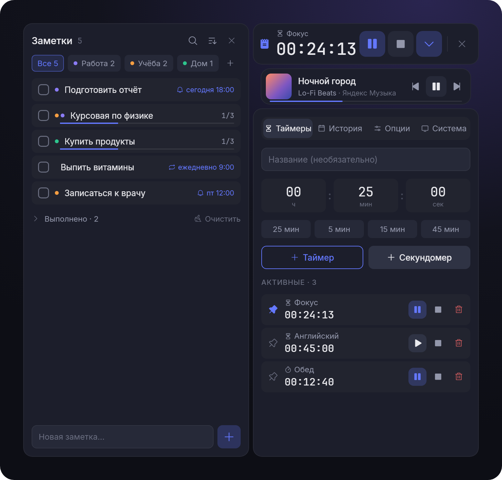
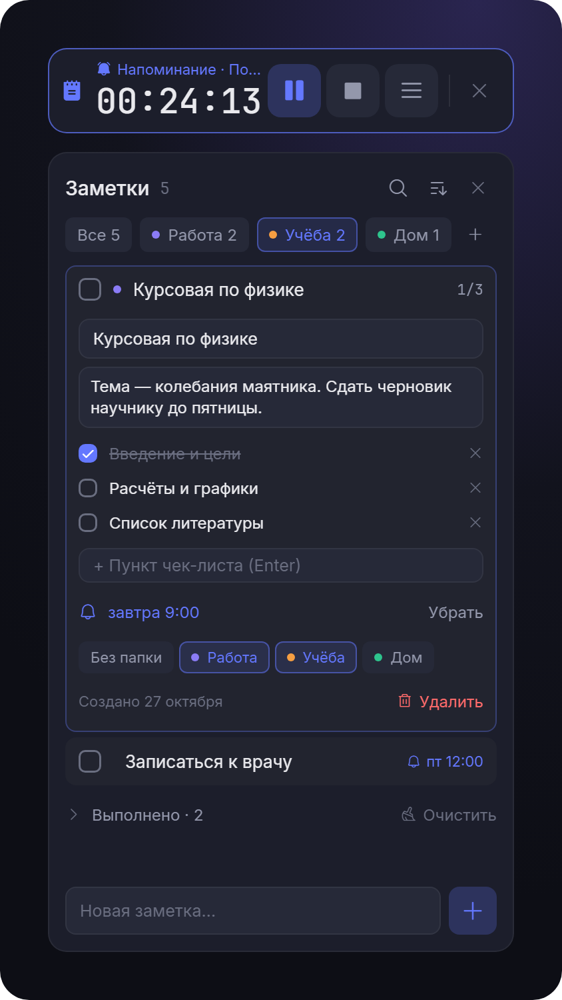
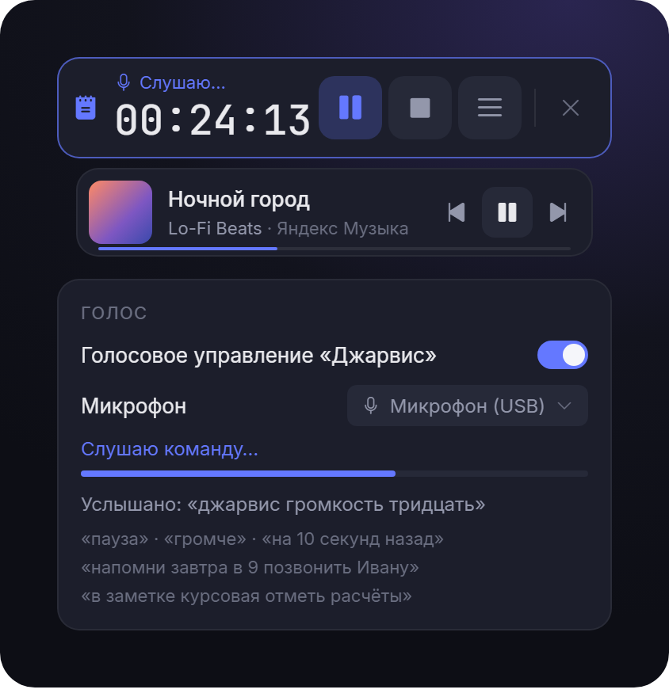

<div align="center">


# Timer Pro

**Плавающий виджет-таймер для Windows — с заметками, напоминаниями, управлением музыкой<br>и офлайн-голосовым помощником «Джарвис» на русском языке.**

[](https://github.com/animedeed/timer-pro/releases/latest)
[](https://github.com/animedeed/timer-pro/releases)
[](#-установка)
[](#-сборка-из-исходников)
[](LICENSE)

<br>

[](https://github.com/animedeed/timer-pro/releases/latest)
&nbsp;
[](https://github.com/animedeed/timer-pro/releases/latest)

<sub>Windows 10/11 x64 · ~55 МБ · права администратора не нужны · работает без интернета</sub>

<br><br>



</div>

<br>

## ✨ Возможности

<table>
<tr>
<td width="50%" valign="top">

### ⏱ Таймеры и секундомеры
Сколько угодно одновременно, закреплённый показывается в виджете. Идущие таймеры продолжают считать даже после перезапуска. История сессий — в календаре по дням.

</td>
<td width="50%" valign="top">

### 📝 Заметки и напоминания
Задачи с чек-листами и прогрессом, папки (заметка может быть сразу в нескольких), сортировка и поиск. Напоминания пишутся словами: «завтра в 9», «через 20 минут», «по будням в 10».

</td>
</tr>
<tr>
<td valign="top">

### 🎙 Голосовой помощник «Джарвис»
Полностью офлайн (Vosk) — ничего не уходит в интернет. Музыка, громкость, перемотка, таймеры, заметки, папки — одной фразой.

</td>
<td valign="top">

### 🎵 «Сейчас играет»
Трек из Яндекс Музыки, Spotify или браузера: пауза, переключение, перемотка, бегущая строка. Громкость плеера голосом — без изменения системной.

</td>
</tr>
<tr>
<td valign="top">

### ⌨️ Горячие клавиши и трей
Глобальные сочетания (включая медиаклавиши и цифровой блок), значок в трее, сворачивание в трей.

</td>
<td valign="top">

### 🪟 Не мешает работе
«Парящие» блоки без рамки, поверх всех окон, тёмная или светлая тема. Уведомления Windows, когда таймер закончился или пора выполнить задачу.

</td>
</tr>
</table>

<div align="center">
<table>
<tr>
<td align="center" valign="top"><br><sub><b>Заметки:</b> чек-лист, напоминание, несколько папок</sub></td>
<td align="center" valign="top"><br><sub><b>Джарвис:</b> «Слушаю…», выбор микрофона, услышанная фраза</sub></td>
</tr>
</table>
<sub>Изображения собраны по макетам интерфейса с демонстрационными данными.</sub>
</div>

## 🎙 Голосовые команды

Скажите «**Джарвис**», затем команду — одной фразой или после короткой паузы. Включается в **Меню → Система → Голос**: там же выбор микрофона, уровень сигнала и что именно услышала модель.

<details open>
<summary><b>Все команды</b></summary>
<br>

| Что | Как сказать |
|---|---|
| Музыка | «пауза», «играй», «дальше», «следующий трек», «назад» |
| Громкость плеера | «громче», «тише» (±10 %), «громче на 20», «громкость 30», «громкость на максимум», «выключи звук», «включи звук» |
| Перемотка | «на 10 секунд назад», «вперёд на минуту», «перемотай назад», «трек сначала» |
| Таймер | «поставь таймер на 25 минут работа», «таймер на полтора часа чтение», «засеки 10 минут» |
| Секундомер | «запусти секундомер обед» |
| Управление | «поставь таймер на паузу», «продолжи таймер», «останови таймер», «удали таймер чай», «тихо» |
| Заметки | «заметка купить молоко», «запиши в папку работа подготовить отчёт» |
| Напоминания | «напомни завтра в девять позвонить Ивану», «напомни через 20 минут проверить духовку», «напоминай каждый день в восемь выпить таблетки» |
| Пункты | «открой заметку покупки», «добавь пункт хлеб», «в заметке курсовая отметь контрольное», «сними отметку с хлеб», «удали пункт сыр» |
| Папки | «создай папку учёба», «положи заметку отчёт в папку работа», «перенеси отчёт в папку учёба», «покажи папку работа» |
| Окно | «покажи заметки», «скрой виджет», «открой меню» |

</details>

## 📥 Установка

1. Откройте [последний релиз](https://github.com/animedeed/timer-pro/releases/latest) и скачайте один из файлов:

   | Файл | Для чего |
   |---|---|
   | `TimerPro-…-Setup.exe` | **Установщик** — ярлыки в «Пуске» и на рабочем столе, удаление через «Приложения». Права администратора не нужны. |
   | `TimerPro-…-portable.zip` | **Без установки** — распакуйте куда угодно и запустите `timer_pro.exe` (папка `vosk` должна лежать рядом). |

2. Запустите. Файлы не подписаны, поэтому SmartScreen может предупредить: **«Подробнее» → «Выполнить в любом случае»**.

## ❓ Вопросы

<details>
<summary><b>Джарвис не реагирует на команды</b></summary>
<br>

Откройте **Меню → Система → Голос** и скажите что-нибудь: полоска уровня должна двигаться. Если стоит на месте — выберите другой микрофон в списке (микрофон Windows «по умолчанию» бывает молчащим, например у Bluetooth-наушников). Строка «Услышано» показывает, во что модель превратила фразу.
</details>

<details>
<summary><b>Нужен ли интернет?</b></summary>
<br>

Нет. Распознавание речи (Vosk) работает на компьютере, модель входит в установщик. Интернет не нужен ни для чего.
</details>

<details>
<summary><b>Где хранятся таймеры, история и заметки?</b></summary>
<br>

В `%APPDATA%\myname\TimerPro\data` (`config.json` и `data.json`). Папку для данных можно сменить в настройках. При обновлении поверх старой версии всё сохраняется.
</details>

<details>
<summary><b>Почему «громче» не двигает ползунок на сайте?</b></summary>
<br>

Голосом меняется громкость самой программы-плеера в микшере Windows (браузера целиком, Spotify, Яндекс Музыки) — на слух это то же самое. Ползунок внутри сайта программе недоступен.
</details>

## 🛠 Сборка из исходников

<details>
<summary><b>Как собрать</b></summary>
<br>

Нужны [Rust](https://rustup.rs/) (stable, MSVC) и Windows 10/11.

```powershell
# 1. Голосовая модель и libvosk (~140 МБ, в репозиторий не входят)
powershell -ExecutionPolicy Bypass -File scripts\get-vosk.ps1

# 2. Сборка и тесты
cargo test
cargo build --release

# 3. Установщик и портативный zip (нужен Inno Setup 6: winget install JRSoftware.InnoSetup)
powershell -ExecutionPolicy Bypass -File scripts\package.ps1
# → installer\TimerPro-<версия>-Setup.exe и installer\TimerPro-<версия>-portable.zip
```

Без шага 1 программа тоже собирается и работает — голосовое управление просто сообщит, что модель не найдена.

Служебные режимы: `timer_pro.exe --test-toast` (уведомления), `--voice-test <папка с wav>` (распознавание файлов), `--voice-listen 20` (живой микрофон), `--volume-list` (программы в микшере громкости).

Релизы собирает GitHub Actions по тегу `v*` (`.github/workflows/release.yml`).
</details>

<details>
<summary><b>Устройство проекта</b></summary>
<br>

| Модуль | Что внутри |
|---|---|
| `src/app.rs` | Окно, блоки виджета, меню, панель заметок, геометрия окна |
| `src/kit.rs`, `src/theme.rs` | Свои виджеты и дизайн-токены (макеты — в `design/`) |
| `src/timer_logic.rs` | Таймеры и секундомеры |
| `src/notes.rs` | Заметки, папки, напоминания, разбор времени («завтра в 9») |
| `src/voice.rs` | Vosk через FFI, захват микрофона, разбор голосовых команд |
| `src/media.rs` | Системные медиаконтролы Windows (SMTC) |
| `src/volume.rs` | Громкость программы-источника музыки в микшере Windows (Core Audio) |
| `src/system.rs` | Горячие клавиши, трей, уведомления |

Интерфейс — [egui](https://github.com/emilk/egui) с рендером OpenGL и прозрачным окном без рамки. Изображения для README — `docs/screenshots/showcase.html`.
</details>

## 📄 Лицензия

[MIT](LICENSE). Сторонние компоненты и их лицензии — в [THIRD_PARTY.md](THIRD_PARTY.md).
